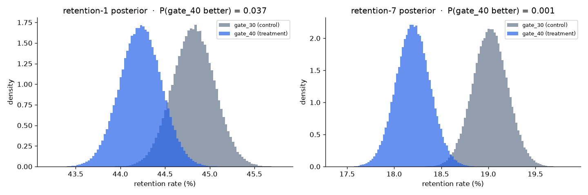
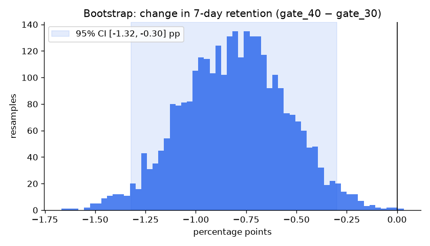
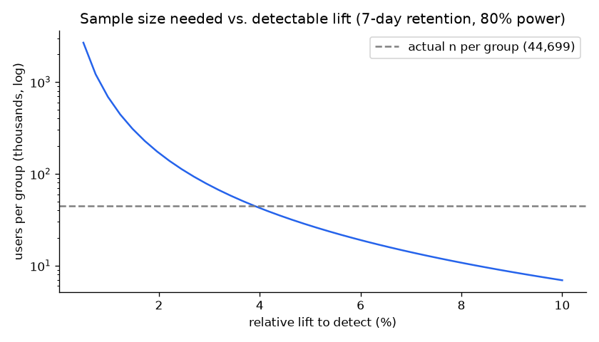
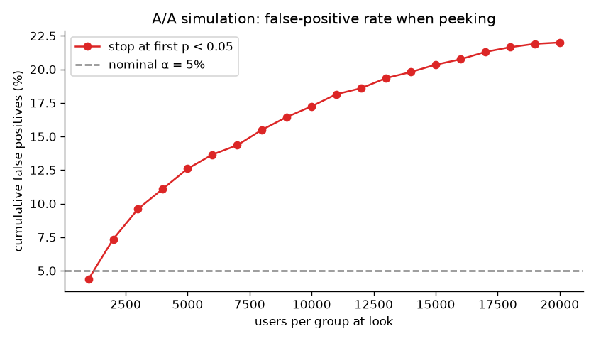

# abkit — A/B Testing Toolkit + Cookie Cats Case Study


 

A small, **tested** Python library for designing and analysing online experiments, applied to a real
A/B test on **90,189 mobile-game players**.

```python
import abkit
abkit.srm_check(44_700, 45_489)                       # is randomisation healthy?
abkit.two_proportion_ztest(8502, 44700, 8279, 45489)  # p-value + CI on the difference
abkit.beta_binomial(8502, 44700, 8279, 45489)         # P(B > A), expected loss
abkit.bootstrap_diff(control, treatment)              # assumption-free CI
abkit.sample_size_proportions(0.19, mde_rel=0.02)     # users needed per group
abkit.cuped(metric, pre_period_metric)                # variance reduction
abkit.simulate_peeking()                              # why you mustn't stop early
abkit.holm_bonferroni({"r1": p1, "r7": p7})           # multiple-metric correction
```

Every function is validated against `statsmodels`/`scipy` reference implementations or known
closed-form results in the test suite.

---

## Case study: should Cookie Cats move its first gate from level 30 to 40?

*Cookie Cats* forces players to wait (or pay) at "gates". The team tested moving the first gate later.

### Results

| Metric | gate_30 (control) | gate_40 | Δ (abs) | 95% CI | p-value | P(gate_40 better) |
|---|---|---|---|---|---|---|
| 1-day retention | 44.82% | 44.23% | −0.59 pp | [−1.24, +0.06] | 0.074 | 3.7% |
| **7-day retention** | **19.02%** | **18.20%** | **−0.82 pp (−4.3%)** | **[−1.33, −0.31]** | **0.0016** | **0.1%** |
| Game rounds (median) | 17 | 16 | −1 | — | 0.051 (Mann-Whitney) | — |

After **Holm–Bonferroni** correction across the three metrics, only **7-day retention** remains significant.



### Recommendation
**Keep the gate at level 30.** Moving it to 40 reduces 7-day retention by ~0.8 percentage points
(≈ 4% relative). Frequentist, bootstrap and Bayesian analyses all agree; the Bayesian probability
that gate 40 is better is 0.1%. A plausible mechanism: an earlier forced break builds anticipation
and spreads play over more days (hedonic adaptation), rather than letting players burn out.



### Rigour checks
- **Sample ratio mismatch:** p = 0.009 — below 0.05 but above the industry 0.001 alarm
  threshold. Worth flagging to engineering, not grounds to discard the test.
- **Outlier:** one player logged 49,854 rounds in 14 days — removed as a logging artefact before analysis.
- **Heavy tails:** game rounds are extremely skewed, so a rank test (Mann-Whitney) is reported alongside
  Welch's t-test; the means are misleading here.
- **Power retrospective:** with ~45k users per group, the test could reliably detect a **≥ 3.9%
  relative** change in 7-day retention. Detecting a 1% lift would have needed ~671k users per group.



### Why peeking is dangerous
An A/A simulation at this experiment's scale: if you check results 20 times and stop at the first
p < 0.05, the false-positive rate climbs from **4.3% to 22%** — more than four times what you think.



---

## Run it

```bash
pip install -e . && pip install -r requirements-dev.txt
pytest -q                          # 10 tests
python analysis/cookie_cats.py     # downloads data, writes reports/results.json + figures
```

## Structure
```
src/abkit/
├── frequentist.py   # SRM check, z-test, Welch, Mann-Whitney, Holm–Bonferroni
├── bayesian.py      # Beta-Binomial posterior, P(B>A), expected loss
├── resampling.py    # vectorised bootstrap CIs
└── design.py        # sample size, power, MDE, CUPED, peeking simulation
analysis/cookie_cats.py
tests/test_abkit.py
```

## Data
Cookie Cats A/B test (Tactile Entertainment, via DataCamp/Kaggle): `userid`, `version`
(gate_30/gate_40), `sum_gamerounds` (first 14 days), `retention_1`, `retention_7`.
